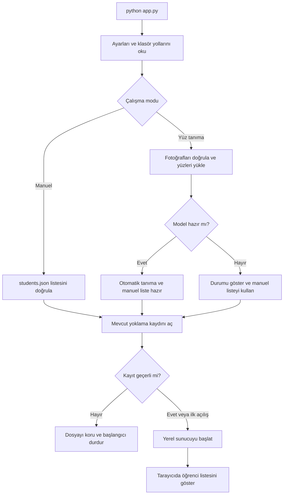
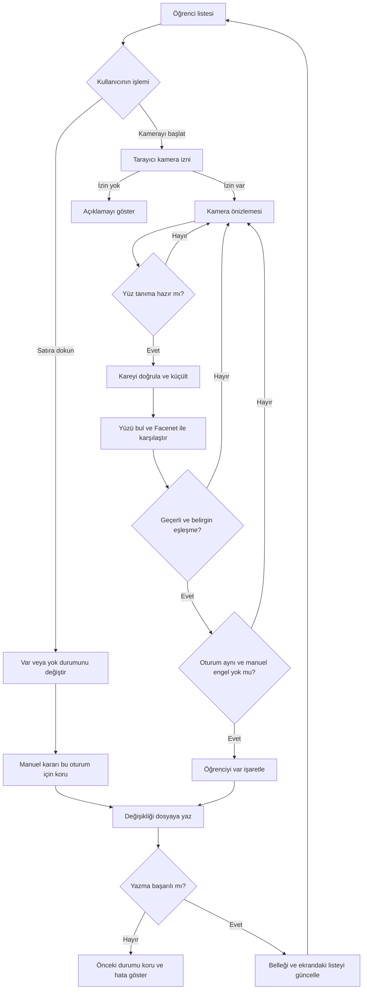
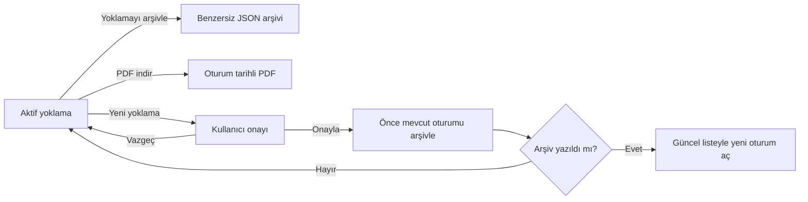

# YoklamaX akış şemaları

GitHub bu Mermaid şemalarını doğrudan çizer. VS Code Markdown önizlemesinde Mermaid desteği yoksa şema kaynağını metin olarak görebilirsiniz.

## Uygulamanın başlangıcı

İlk açılışta kayıt dosyası yoksa boş durumlu bir oturum oluşturulur. Demo seçeneği, daha önce tanımlanmış kurmaca listeyi ayrı veri diziniyle açar.

## Kamera ve manuel yoklama

Kamera kapatıldığında medya akışı ve bekleyen istekler durdurulur. Eşleşme için kimlik bilgileri dosya adından gelir; görüntüden isim tahmini yapılmaz.

## Arşiv, PDF ve yeni yoklama

Yeni oturumun yazımı da başarısız olursa eski aktif yoklama korunur; oluşturulmuş arşiv kullanılabilir. Kayıt biçiminin ayrıntısı `attendance_store.py` içindedir.
